# OTLP metrics in the trace-metrics store — what the PoC does and why

Companion to `README.md` (how to run the bench), `FIXES.md` (what broke) and `OVERVIEW.md` (short version). This doc explains
the design that was actually built on the `poc/metrics/otlp-delta-histograms` branches of
relay / snuba / sentry, the decisions behind it, and what it costs. It also answers the review
doc "OTLP Pre-Aggregated Metrics — Our Approach vs. OTel and Competitors": the PoC implements
its main recommendation (use the bucket bounds at query time) and verified it against Prometheus.

## What we're trying to do

Accept OTLP metrics (counters, gauges, histograms, exponential histograms) into the same EAP
"trace metrics" item type that the Sentry SDKs already write, so they show up in Explore >
Metrics, dashboards and alerts with no new storage. Counters and gauges map 1:1 onto existing
rows. Histograms don't — an OTLP histogram data point is already an aggregate (bucket counts,
count, sum, min, max) and the store only knows single values. Everything interesting in this
PoC is about that mismatch.

## Three ways to represent a histogram point

| | `metric.type = histogram` (chosen) | `distribution` + `otlp.*` attributes | Separate item type / table |
| --- | --- | --- | --- |
| Rows | one row per non-empty bucket + one per exemplar; new type value | same rows, but typed `distribution`; bucket data in `otlp.bucket_lower` etc. | one row per data point with array columns for bounds/counts, or a new `TRACE_ITEM_TYPE` |
| Query | Snuba rewrites `sentry.value` aggregations when bucket attributes exist; type lets Sentry pick aggregates/UI | identical rewrite keyed on attribute presence | native array functions; nothing to rewrite |
| Why / why not | UI and backend can branch on type (samples tab = exemplars, no heatmap, aggregate list); SDK `distribution` and OTLP `histogram` never silently mix | smallest change, existing dashboards keep working — but a "distribution" whose rows aren't samples is a lie the UI can't detect, and a point's buckets and real SDK samples under one name get merged with no warning | the "right" schema (one row per point, no 10× row amplification, downsampling per point) but needs a new item type through Relay, Kafka, Snuba RPC, Sentry search and every UI surface |

The PoC picked the first because it is the smallest change that still lets the product tell
histograms apart. The third is where a production version probably ends up if row amplification
(below) becomes a cost problem; the second is strictly worse than the first for the same work.
(The third option is reconstructed from the discussions; the first two are what was debated.)

## Decisions

- Delta temporality only. Cumulative Sum/Histogram points and all Summary points are dropped in
  Relay. The store is append-only rows; a cumulative series would need per-series state to turn
  into deltas (New Relic and the Datadog Agent do this; Prometheus is the opposite and treats
  cumulative as native). OTel SDKs default to cumulative, so a Collector `cumulativetodelta`
  processor or `temporalityPreference: DELTA` on the exporter is required. The bench uses the
  latter.
- One row per non-empty bucket, not one per point. Keeps the existing row shape (one
  `sentry.value` + attributes) so nothing in the write path changes. `sentry.value` on a bucket
  row is the bucket midpoint — display only, never used by an aggregate.
- Bucket bounds are stored (`bucket_lower`, `bucket_upper`) and used at query time. This is the
  review doc's recommendation and what Prometheus `histogram_quantile` does. The earlier design
  fed the midpoint into t-digest weighted by count; that puts p90 at ≈327 ms for the example
  below where the true answer is ≤250.
- Open-ended edge buckets `(-inf, b0]` and `(bN, +inf)` are clamped to the point's `min`/`max`
  when those fall inside the bucket, otherwise collapsed to the finite bound. Prometheus returns
  the finite bound; we are slightly more accurate when min/max are present.
- `sum_share` per bucket. `sum()` has to be exact and mergeable, so each bucket row carries its
  share of the point's `sum`, split proportionally to `count × midpoint` (falls back to
  proportional by count when the midpoints sum to 0, and to `count × midpoint` when the point
  has no sum). Σ `sum_share` over the point's rows equals `sum` exactly.
- Exponential histograms are converted to the same bucket rows: base-2 bounds
  `2^(index · 2^-scale)`, negative buckets mirrored, the zero bucket becomes
  `[-zero_threshold, +zero_threshold]`, and the scale is halved until ≤ 64 non-empty buckets.
  After that they are indistinguishable from explicit buckets.
- Exemplars are rows too (`row_kind = exemplar`), with the exemplar's real `trace_id`/`span_id`,
  its own timestamp, its value, and the point's attributes plus `filtered_attributes`. They never
  contribute to aggregates. They are the only rows of a histogram that represent a real
  measurement, so the Explore samples tab for histograms shows exemplars and nothing else (see
  FIXES.md addendum). The OTel JS SDK doesn't emit exemplars; the bench injects them itself
  (`app/exemplars.mjs`).
- `point_id` (a UUID per data point, also used as the point's synthetic `trace_id` for bucket
  rows) is an implementation detail so Snuba can see which rows belong together. It is not
  surfaced in the UI.
- Plain SDK rows are zero-width buckets. Snuba treats a row without bucket attributes as
  `[value, value] × 1`, so counters, gauges and SDK distributions go through the same code and
  produce the same numbers as before. The PoC applies the rewrite to every `sentry.value`
  aggregation (no proto flag); production would gate it.

## Implementation

What happens to one OTLP histogram data point:

```mermaid
flowchart LR
  SDK["OTel SDK / Collector<br/>OTLP/HTTP JSON or protobuf<br/>temporality = DELTA"] -->|"POST /api/{project}/integration/otlp/v1/metrics"| Relay
  subgraph Relay["Relay (relay-server/.../trace_metrics/integrations/otel.rs)"]
    V["validate: delta? count>0? finite sum/min/max?<br/>drop cumulative + summary"] --> B["non-empty buckets<br/>clamp edges to min/max<br/>exp. histogram → downscale ≤64, base-2 bounds"]
    B --> R["rows: 1 bucket row per bucket (value = midpoint, sum_share)<br/>1 exemplar row per exemplar (real trace/span id)<br/>all share point_id, resource.* / instrumentation.* / point attrs"]
  end
  R -->|"snuba-items topic<br/>~725 B / bucket row, ~436 B / exemplar row"| Kafka
  Kafka --> Snuba["Snuba items consumer<br/>attributes hashed into 40 string + 40 float maps"]
  Snuba --> CH[("ClickHouse eap_items_1_local<br/>item_type = 8")]
  CH --> Q["Snuba RPC (histogram_aggregation.py)<br/>count = Σ bucket_count · sum = Σ sum_share<br/>min/max from bounds · pNN = rank in merged buckets + interpolate<br/>(or k-points: arrayJoin each bucket into k weighted points)<br/>row_kind = exemplar excluded"]
  Q --> UI["Sentry Explore › Metrics<br/>type = histogram<br/>Samples tab = exemplar rows → trace view<br/>Heatmap (k-points mode only)"]
```



### The example point

`http.server.request.duration`, unit `ms`, default explicit bounds
`[0, 5, 10, 25, 50, 75, 100, 250, 500, 750, 1000, 2500, 5000, 7500, 10000]` (16 buckets), 1000
requests in a 10 s export window of which 900 took (100, 250], 80 took (250, 500] and 20 took
(500, 750]. Sum 190 000, min 102.4, max 712.9, two exemplars. Resource attributes are what a
typical k8s deployment sends.

```json
{"resourceMetrics":[{"resource":{"attributes":[
  {"key":"service.name","value":{"stringValue":"checkout"}},
  {"key":"service.version","value":{"stringValue":"2026.10.28"}},
  {"key":"deployment.environment","value":{"stringValue":"prod"}},
  {"key":"k8s.namespace.name","value":{"stringValue":"shop"}},
  {"key":"k8s.pod.name","value":{"stringValue":"checkout-7d9f8c6b5-x2k9q"}},
  {"key":"k8s.node.name","value":{"stringValue":"gke-prod-pool-1-a1b2"}},
  {"key":"k8s.deployment.name","value":{"stringValue":"checkout"}},
  {"key":"k8s.container.name","value":{"stringValue":"checkout"}},
  {"key":"host.name","value":{"stringValue":"gke-prod-pool-1-a1b2"}},
  {"key":"cloud.provider","value":{"stringValue":"gcp"}},
  {"key":"cloud.region","value":{"stringValue":"us-central1"}}]},
 "scopeMetrics":[{"scope":{"name":"@opentelemetry/instrumentation-http","version":"0.58.0"},
  "metrics":[{"name":"http.server.request.duration","unit":"ms","histogram":{
   "aggregationTemporality":1,
   "dataPoints":[{
    "attributes":[
      {"key":"http.request.method","value":{"stringValue":"GET"}},
      {"key":"http.route","value":{"stringValue":"/api/search"}},
      {"key":"http.response.status_code","value":{"intValue":"200"}}],
    "startTimeUnixNano":"1793219139337000000","timeUnixNano":"1793219149339000000",
    "count":"1000","sum":190000.0,"min":102.4,"max":712.9,
    "bucketCounts":["0","0","0","0","0","0","0","900","80","20","0","0","0","0","0","0"],
    "explicitBounds":[0,5,10,25,50,75,100,250,500,750,1000,2500,5000,7500,10000],
    "exemplars":[
      {"timeUnixNano":"1793219142926000000","asDouble":698.2,"spanId":"a26f9ca65f49ce94",
       "traceId":"79e1697ab3f064add65766b761de8c81","filteredAttributes":[{"key":"cache","value":{"stringValue":"miss"}}]},
      {"timeUnixNano":"1793219148867000000","asDouble":131.7,"spanId":"31492896dad305ad",
       "traceId":"fddc2ce6c29df4bf5a41a6d5bcb08c52","filteredAttributes":[{"key":"cache","value":{"stringValue":"hit"}}]}]
   }]}}]}]}]}
```

1 871 bytes as compact JSON (roughly 900 as protobuf). It becomes **5 rows**:

| row | `row_kind` | `value` | `bucket_lower` | `bucket_upper` | `bucket_count` | `sum_share` | `trace_id` / `span_id` | timestamp |
| --- | --- | --- | --- | --- | --- | --- | --- | --- |
| 1 | bucket | 175 (midpoint) | 100 | 250 | 900 | 149 625 | point_id / — | point `timeUnixNano` |
| 2 | bucket | 375 | 250 | 500 | 80 | 28 500 | point_id / — | same |
| 3 | bucket | 625 | 500 | 750 | 20 | 11 875 | point_id / — | same |
| 4 | exemplar | 698.2 | — | — | — | — | `79e1697a…` / `a26f9ca6…` | exemplar's |
| 5 | exemplar | 131.7 | — | — | — | — | `fddc2ce6…` / `31492896…` | exemplar's |

`sum_share` = `count × midpoint × (sum / Σ count × midpoint)` = `900 × 175 × 190000/200000`
etc.; the three shares add to exactly 190 000. Every row also carries `histogram_count = 1000`,
`histogram_sum = 190000`, `histogram_min = 102.4`, `histogram_max = 712.9` (bucket rows only),
`sentry._internal.start_timestamp_precise`, and the full attribute set below. The 13 empty
buckets produce nothing. No edge clamping happens here because the open-ended buckets are empty.

### One row as stored in ClickHouse

This is a real bucket row from the bench (`project_id = 2`, `item_type = 8`), only the resource
attributes differ from the example above (the bench sends three). Attributes are spread across
`attributes_string_0..39`, `attributes_float_0..39`, `attributes_int`, `attributes_bool` by key
hash; shown here concatenated.

```
timestamp:      2026-10-28 20:25:49
trace_id:       d9989b98-8596-43f5-8723-c87af2a73345        -- = point_id, synthetic
span_id:        (empty)
sampling_weight: 1   retention_days: 90

strings:
  sentry.metric_name = http.server.request.duration
  sentry.metric_type = histogram
  sentry.metric_unit = millisecond
  sentry._internal.row_kind = bucket
  sentry._internal.point_id = d9989b98859643f58723c87af2a73345
  sentry._internal.source = otlp
  sentry.origin = auto.otlp.metrics
  sentry.environment = local
  sentry.observed_timestamp_nanos = 1793219149355727000
  resource.service.name = otlp-poc
  resource.service.version = poc
  resource.deployment.environment = local
  instrumentation.name = otlp-poc
  http.request.method = GET
  http.route = /api/search

floats / ints:
  sentry.value = 2.5                                        -- midpoint of (0, 5]
  sentry._internal.bucket_lower = 0
  sentry._internal.bucket_upper = 5
  sentry._internal.bucket_count = 64
  sentry._internal.sum_share = 159.84
  sentry._internal.histogram_count = 67
  sentry._internal.histogram_sum = 11398.78
  sentry._internal.histogram_min = 0.0559
  sentry._internal.histogram_max = 4973.43
  sentry._internal.start_timestamp_precise = 1793219139337000000
  sentry.timestamp_precise = 1793219149339000000
  sentry._internal.received_at / ingested_at
  sentry.payload_size_bytes = 724
  http.response.status_code = 200

bools:
  sentry._internal.cooccuring.name.http.server.request.duration = true
  sentry._internal.cooccuring.type.histogram = true
  sentry._internal.cooccuring.unit.millisecond = true
```

The sibling exemplar row differs in: `row_kind = exemplar`, `trace_id`/`span_id` are the real
span's, `sentry.value` is the measured value, timestamp is the exemplar's, `cache = hit|miss`
(filtered attribute), and no `bucket_*` / `histogram_*` keys (`payload_size_bytes = 436`).

The query side, for `p90(value)` on the example point: Snuba merges rows by `(lower, upper)` →
`[(100,250)→900, (250,500)→80, (500,750)→20]`, cumulative `[900, 980, 1000]`, target `0.9 × 1000 =
900`, first bucket whose cumulative ≥ 900 is the first one, result `100 + 150 × 900/900 = 250`.
p95 → `250 + 250 × 50/80 = 406.25`, p99 → `500 + 250 × 10/20 = 625`, p50 → `183.3`. Prometheus
`histogram_quantile` gives the same numbers. `count() = 1000`, `sum() = 190000`, `avg = 190`,
`min = 100`, `max = 750` (bounds, not the point's 102.4/712.9 — those are in `histogram.min/max`).

### Size

Measured on the bench (`http.server.request.duration`, one series, 10 s export interval):

| | per OTLP point | rows | Relay-serialized bytes (Kafka) | notes |
| --- | --- | --- | --- | --- |
| explicit histogram, bimodal load | 1 | 1.97 bucket + 4 exemplar | ~725 / bucket row, ~436 / exemplar | only 2 of 16 buckets are populated |
| explicit histogram, 32-bucket layout, log-normal load | 1 | up to 27 bucket + 4 exemplar | same per row | one row per populated bucket; the layout, not the data, sets the row count |
| exponential histogram, same load | 1 | 28.3 bucket (max 42) + 4 exemplar | ~728 / bucket row | base-2 at scale ≥ 3 puts a bucket every few % |
| counter / gauge | 1 | 1 point | ~350–410 | |
| example point above | 1 | 3 bucket + 2 exemplar | ≈ 3 050 B total | vs 1 871 B of OTLP JSON in |

ClickHouse on-disk for the bench table (1.47 M rows, 58% of them these metric rows, the rest
logs): 202 MiB compressed / 4.9 GiB uncompressed → **~145 B/row compressed**, ~3.5 KB/row
uncompressed. The in-memory width of one row (`byteSize(*)`) is 2.4–2.8 KB, dominated by the 80
map columns. With the k8s resource set from the example (11 resource attrs instead of 3) each
row grows by ~400 B uncompressed; compressed growth is small because the values repeat on every
row of a series, but they do get hashed into the string maps and paid for on every query that
touches those maps.

What that means: an explicit-bucket histogram costs 1 row per populated bucket per series per
export interval. A well-behaved latency histogram populates 5–8 of 16 default buckets, so 6–9×
the rows of a gauge, plus up to one exemplar per populated bucket if the SDK sends them. An
exponential histogram with the SDK default (160 buckets, downscaled to 64 here) is 25–60 rows
per point and is the thing to watch.

## Risks

- Percentile accuracy is bounded by the bucket layout, not by us. Interpolation assumes uniform
  spread inside a bucket; with the default bounds a tail in (2500, 5000] gives p95 ≈ 2917 for both
  Sentry and Prometheus, which is a bucket artifact. Users with coarse or mis-unit buckets
  (seconds recorded against ms bounds, so everything lands in (0, 5]) get a "correct" but
  useless percentile. Exponential histograms are far better here (relative error per bucket)
  but cost rows.
- Merging mixed bucket layouts is approximate. `sumMap` by `(lower, upper)` is exact when
  bounds match; when a service changes its View or an exponential series downscales mid-window,
  non-nested ranges interleave and the interpolation degrades silently.
- Exponential bucket cap of 64 halves the resolution at every downscale (~±9% at 64 vs ±4% at the
  SDK's 160). It's a constant in Relay; raising it multiplies rows.
- Confidence intervals / reliability for histogram percentiles still use the t-digest-over-
  `value` expression and are meaningless in interpolation mode (they no longer crash, see
  FIXES.md). k-points mode runs them on the expanded points, which is at least well-defined.
- Downsampled tiers sample by `item_id`, so the buckets of one point are kept or dropped
  independently. Percentiles over a downsampled tier would mix partial points. Not addressed;
  hash `point_id` or always read histograms from the full tier.
- The query rewrite is keyed on `sentry.value` with no proto flag, and the percentile path keeps
  one map entry per distinct `(lower, upper)` — for SDK distributions that's one per distinct
  value, which is unbounded. Needs a flag and a fallback before production.

## Caveats

- Delta only. Default OTel SDK and Collector traffic is cumulative and is dropped silently (debug
  log, no outcome). Also no `start_time` based rate yet, so a long export interval shows as one
  spike.
- Heatmaps need k-points mode. The heatmap endpoint is `count_if(value >= lo AND value < hi)`
  per time interval, which on bucket rows would drop a whole bucket into the cell holding its
  midpoint. With `SNUBA_OTLP_HISTOGRAM_POINTS_PER_BUCKET = k` Snuba expands each bucket row into
  k evenly spaced points via `arrayJoin(range(k))` (value `lower + width·(i+0.5)/k`, weight
  `bucket_count/k`; plain/exemplar rows keep i = 0) and rewrites every `sentry.value` filter and
  aggregate onto the expanded value: count/sum/avg as weighted sums, percentiles as
  `quantileTDigestWeighted(q)(value, round(weight·1000))`. The fixture's (2500,5000] × 600 lands as
  120 per 500 ms cell; percentiles on the fixture alone match interpolation mode exactly, and on
  a large mixed window snap to the `width/k` lattice (p50 2.75 vs 2.66, p99 4625 vs 4583 at k = 10).
  Cost is k× the bucket rows per query (ClickHouse CSEs identical `arrayJoin`s, so once per
  query, not per aggregate). Measured on a 32-bucket layout over ~100 k rows (README "Query
  cost"): the aggregate table is ~2× *faster* at k = 10 than rank mode (one weighted t-digest
  beats `sumMap` + `arrayCumSum` per percentile) and even at k = 32; the p95 timeseries is a
  wash; the heatmap is 3–4× slower at k = 10 and ~8× at k = 32 with memory scaling with k.
  Default is 0 = exact rank + interpolation, no heatmap.
- Exemplars only exist if the SDK sends them. OTel JS doesn't; Java/Go/Python do with the
  `trace_based` filter (only inside sampled spans). Without them the histogram Samples tab is
  empty and says so.
- Dropped data: Summary metrics, cumulative anything, delta `UpDownCounter` (stored as gauge
  today — wrong, should be rejected), NaN/Inf points, `count = 0` histograms.
- Resource attributes are copied onto every row as `resource.*` (and scope as
  `instrumentation.*`). Filter names therefore differ from OTel (`resource.service.name`). An
  allowlist/promotion decision is still open.
- Explore shows `min`/`max` from bucket bounds; the point's true min/max are the searchable
  `histogram.min` / `histogram.max` attributes.

## What was verified

Same JS app sends identical metrics to Relay (delta) and Prometheus 3.x (cumulative, native OTLP
receiver). Over a 10 minute window at 1 m intervals, point by point: request counts and p50/p99
agree within 1%; p95 is noisy on both sides for the same reason (6% tail in one bucket); gauge
within a couple of points. The fixed fixture (10 000 obs: 9 400 in (0,5], 600 in (2500,5000])
gives p50/p95/p99 = 2.6596 / 2916.67 / 4583.33 on both. Exemplars from live spans land in both
stores with the same trace ids and resolve to traces in Sentry. Details, URLs and screenshots in
`README.md`.
