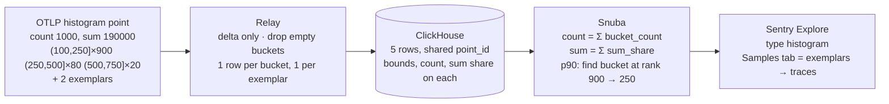

# OTLP metrics in Sentry — the short version

Full detail in `DESIGN.md`; how to run it in `README.md`.

## What it is

Sentry accepts OpenTelemetry metrics (OTLP) straight into the same store the Sentry SDK metrics
use. Counters and gauges are a row each, like today. Histograms — which arrive already
aggregated as "N observations fell between a and b" — are stored as one row per non-empty bucket
plus one row per exemplar, and the query layer knows how to turn those rows back into
count / sum / min / max / percentiles. The result shows up in Explore > Metrics as a new metric
type, `histogram`, with the same aggregates as a distribution.

A PoC of this runs end to end (Relay → Snuba → Sentry UI) and was checked against Prometheus +
Grafana fed the same data: counts and percentiles match.

## How a histogram is represented

Three options were on the table:

1. **`metric.type = histogram`** — a new type, bucket data in internal attributes. Chosen: the UI
   and backend can tell histograms apart (samples = exemplars, no heatmap) and OTLP histograms
   never get mixed with SDK distributions by accident.
2. **Reuse `distribution`, mark rows with `otlp.*` attributes** — least work, but a
   "distribution" whose rows are buckets rather than samples is something the UI can't detect,
   and mixing it with real SDK samples under one name gives wrong answers quietly.
3. **A separate item type / table** with one row per point and array columns for the buckets —
   the cleanest schema and no row amplification, but a new type through every layer. Where a
   production version probably lands if row cost becomes the problem.

## Implementation

The example above becomes:

| row | kind | value | lower | upper | count | sum share | trace |
| --- | --- | --- | --- | --- | --- | --- | --- |
| 1 | bucket | 175 | 100 | 250 | 900 | 149 625 | synthetic (point id) |
| 2 | bucket | 375 | 250 | 500 | 80 | 28 500 | synthetic |
| 3 | bucket | 625 | 500 | 750 | 20 | 11 875 | synthetic |
| 4 | exemplar | 698.2 | | | | | real trace + span |
| 5 | exemplar | 131.7 | | | | | real trace + span |

p90 = 250, p95 = 406, p99 = 625, sum = 190 000, count = 1000 — identical to what Prometheus
computes from the same point. The old approach (one value per bucket into t-digest) would have
said p90 ≈ 327.

Size: ~1.9 KB of OTLP JSON in → 5 rows, ~3 KB on Kafka, ~145 B/row compressed on disk in the
bench. A typical latency histogram fills 5–8 of the 16 default buckets, so a histogram series costs
roughly 6–9× a gauge series per export interval. Exponential histograms (base-2 buckets,
capped at 64) are 25–60 rows per point and are the cost to watch. Resource attributes (service,
k8s pod/node/namespace, cloud region, …) are copied onto every row as `resource.*`.

## Risks

- **Percentile accuracy** is only as good as the sender's buckets. We interpolate inside the
  bucket that holds the rank (same as Prometheus), so a coarse or wrongly-scaled bucket layout
  gives a plausible but imprecise number. Exponential histograms fix this at the cost of rows.
- **Mixed bucket layouts** in one query (a service changed its buckets, or exponential scales
  differ) degrade quietly.
- **Downsampled tiers** sample rows, not points, so a point's buckets can be split; histograms
  should read the full tier until that's fixed.
- **Reliability / confidence intervals** on histogram percentiles are not meaningful yet.

## Caveats

- **Delta temporality only.** OTel SDKs default to cumulative; without `temporalityPreference:
  DELTA` or a Collector `cumulativetodelta` step the points are dropped.
- **No heatmaps** for histograms — the heatmap needs per-observation values or a fixed grid,
  and bucket bounds vary per point.
- **Exemplars** are the only "samples" a histogram has, and only exist if the SDK sends them
  (OTel JS doesn't by default). Without them the Samples tab is empty and explains why. Trace
  links work when the trace was also sent to Sentry.
- **Exponential histograms** are converted to ordinary bucket rows (zero and negative buckets
  included, scale reduced until ≤ 64 buckets), after which they behave like explicit ones.
- Dropped: Summary metrics, anything cumulative, NaN/Inf values, empty points.
