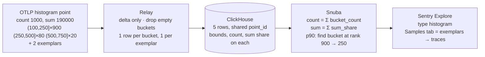

# OTLP metrics in Sentry — the short version

Full detail in `DESIGN.md`; how to run it in `README.md`.

## What it is

Sentry accepts OpenTelemetry metrics (OTLP) straight into the same store the Sentry SDK metrics
use. Counters and gauges are a row each, like today. Histograms — which arrive already
aggregated as "N observations fell between a and b" — are stored as one row per non-empty bucket
plus one row per exemplar, and the query layer knows how to turn those rows back into
count / sum / min / max / percentiles. The result shows up in Explore > Metrics as a new metric
type, `histogram`, with the same aggregates as a distribution.

A PoC of this runs end to end (Relay → Snuba → Sentry UI) and was checked against Prometheus +
Grafana fed the same data: counts and percentiles match.

## How a histogram is represented

Three options were on the table:

1. **`metric.type = histogram`** — a new type, bucket data in internal attributes. Chosen: the UI
   and backend can tell histograms apart (samples = exemplars, bucket-aware math) and OTLP histograms
   never get mixed with SDK distributions by accident.
2. **Reuse `distribution`, mark rows with `otlp.*` attributes** — least work, but a
   "distribution" whose rows are buckets rather than samples is something the UI can't detect,
   and mixing it with real SDK samples under one name gives wrong answers quietly.
3. **A separate item type / table** with one row per point and array columns for the buckets —
   the cleanest schema and no row amplification, but a new type through every layer. Where a
   production version probably lands if row cost becomes the problem.

## Implementation

The example above becomes:

| row | kind | value | lower | upper | count | sum share | trace |
| --- | --- | --- | --- | --- | --- | --- | --- |
| 1 | bucket | 175 | 100 | 250 | 900 | 149 625 | synthetic (point id) |
| 2 | bucket | 375 | 250 | 500 | 80 | 28 500 | synthetic |
| 3 | bucket | 625 | 500 | 750 | 20 | 11 875 | synthetic |
| 4 | exemplar | 698.2 | | | | | real trace + span |
| 5 | exemplar | 131.7 | | | | | real trace + span |

p90 = 250, p95 = 406, p99 = 625, sum = 190 000, count = 1000 — identical to what Prometheus
computes from the same point. The old approach (one value per bucket into t-digest) would have
said p90 ≈ 327.

Size: ~1.9 KB of OTLP JSON in → 5 rows, ~3 KB on Kafka, ~145 B/row compressed on disk in the
bench. A typical latency histogram fills 5–8 of the 16 default buckets, so a histogram series costs
roughly 6–9× a gauge series per export interval. Exponential histograms (base-2 buckets,
capped at 64) are 25–60 rows per point and are the cost to watch. Resource attributes (service,
k8s pod/node/namespace, cloud region, …) are copied onto every row as `resource.*`.

## Billing

Trace metrics are billed in two categories, `trace_metric` (count) and `trace_metric_byte`.
For OTLP, Relay bills the **rows it produces**, not the point it received: when it expands an
OTLP payload it undoes the inbound item's count and size and replaces them with one unit per row
and the row's calculated size (`metric name + 8 B value + Σ attribute key + value bytes`; this is
also stored on the row as `sentry.payload_size_bytes`). Resource and scope attributes are
copied onto every row, so they are billed once per row.

The example point above, sent as 1 871 B of JSON (≈ 900 B as protobuf):

| row | billed bytes | of which resource + scope attrs |
| --- | --- | --- |
| bucket (100, 250] × 900 | 1 072 | 497 |
| bucket (250, 500] × 80 | 1 072 | 497 |
| bucket (500, 750] × 20 | 1 072 | 497 |
| exemplar 698.2 | 784 | 497 |
| exemplar 131.7 | 783 | 497 |
| **total** | **5 units, 4 783 B** | 2 485 B (52%) |

So one data point in = 5 `trace_metric` units and ~4.8 KB of `trace_metric_byte`, against 1 unit
and 1.9 KB if we billed what was sent — 5× the count and ~2.6× the bytes (≈ 5× vs protobuf).
Without exemplars it is 3 units and 3.2 KB (1.7× the bytes). The row count scales with populated
buckets: a histogram that fills 8 of the 16 default buckets is 8 units per point per series per
export interval; the exponential histogram in the bench averaged 28.

Exemplars cost extra. Each is a full row carrying the whole resource/scope/point attribute
set plus trace and span ids — in the example they are 2 of 5 units and a third of the bytes. The
OTel SDK default for explicit histograms is up to one exemplar per populated bucket, which would
roughly double a histogram's bill when the service is traced. Counters and gauges are
unaffected: one point is one row, billed at roughly the same size as the row Relay would produce
from the Sentry SDK (~350–410 B in the bench).

Half the bytes in the example are the same eleven k8s/service resource attributes repeated on
every row. An allowlist (or not prefixing/copying resource attributes onto bucket rows) is the
single biggest lever on cost; moving to one row per point (option 3) is the other.

## Risks

- **Percentile accuracy** is only as good as the sender's buckets. We interpolate inside the
  bucket that holds the rank (same as Prometheus), so a coarse or wrongly-scaled bucket layout
  gives a plausible but imprecise number. Exponential histograms fix this at the cost of rows.
- **Mixed bucket layouts** in one query (a service changed its buckets, or exponential scales
  differ) degrade quietly.
- **Downsampled tiers** sample rows, not points, so a point's buckets can be split; histograms
  should read the full tier until that's fixed.
- **Reliability / confidence intervals** on histogram percentiles are not meaningful yet.

## Caveats

- **Delta temporality only.** OTel SDKs default to cumulative; without `temporalityPreference:
  DELTA` or a Collector `cumulativetodelta` step the points are dropped.
- **Heatmaps** work only in "k-points" mode: Snuba expands each bucket row into k evenly spaced
  points (`arrayJoin`) so a bucket's count is spread over the y-cells it covers. Same trick makes
  t-digest percentiles and value filters work on bucket rows at a resolution of `bucket_width / k`.
  Measured at k = 10 on a 32-bucket layout: aggregate table ~2× faster than the rank path,
  timeseries equal, heatmap 3–4× the cost of a (wrong) midpoint heatmap. Off by default
  (`SNUBA_OTLP_HISTOGRAM_POINTS_PER_BUCKET`).
- **Exemplars** are the only "samples" a histogram has, and only exist if the SDK sends them
  (OTel JS doesn't by default). Without them the Samples tab is empty and explains why. Trace
  links work when the trace was also sent to Sentry.
- **Exponential histograms** ship a `scale` and sparse counts, not bounds. Relay computes the
  exact base-2 bounds (`2^(i·2^-scale)`) and stores them as the same bucket rows an explicit
  histogram gets, so storage and queries don't know they were exponential. That is lossless,
  except: if one point has more than 64 populated buckets Relay halves the scale until it fits
  (SDK default is 160 → two halvings, ~±4% → ~±9% per bucket). The cap only bounds rows per
  point and is a constant. What's lost by not keeping `scale` is exact merging across points
  with different scales and the cue to interpolate in log space; both can be added back with a
  `bucket_scale` attribute without changing the row layout.
- Dropped: Summary metrics, anything cumulative, NaN/Inf values, empty points.
